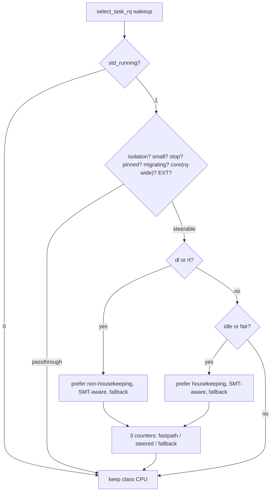

# Smart Task Distributor (STD)

## Overview

STD aims to provide better desktop interactivity by SMT-aware steering of DL and RT tasks away from Fair and idle tasks; extensible (EXT) tasks defer to SCX and are not steered.

STD steers wakeups above deadline without a new scheduling class. Fair and idle tasks prefer housekeeping CPUs. Deadline and real-time tasks prefer non-housekeeping CPUs. Affinity uses `cpumask` intersection with fallback and SMT-aware selection. Stop tasks are never intercepted while pinned, migrate-disabled, core-scheduled (rq-wide, may over-skip) and EXT pass through.

> [!NOTE]
> STD disables itself on <3 online CPUs.

## Project Structure

```text
.
├── src/                          # reference sources (std.c, std.h)
├── patches/vanilla-arch/7.3/     # 0001..0004 + series (v7.3 only)
│   ├── 0001-std-kconfig.patch
│   ├── 0002-std-build.patch
│   ├── 0003-std-shim.patch       # sysctl, stats table, boot param
│   ├── 0004-std-hooks.patch      # select_task_rq hook
│   └── series
├── scripts/
│   ├── install.sh                # apply, build, install, health gate
│   ├── uninstall.sh              # reverse + allowlisted --remove
│   └── cleanup.sh                # stale objects (*.orig/*.rej, std.o)
├── benchmarks/                   # placeholder for wakeup measurements
└── linux-fresh-7.3/              # target tree (never committed)
```

## Quick Start

```bash
# preview only (no mutation)
bash -n scripts/install.sh
shellcheck scripts/install.sh
scripts/install.sh --dry-run --boot-dir /tmp/mock-boot linux-fresh-7.3
scripts/install.sh --status --boot-dir /tmp/mock-boot linux-fresh-7.3

# install (two-key guard)
scripts/install.sh --yes linux-fresh-7.3

# with opt-ins
scripts/install.sh --yes --install-deps linux-fresh-7.3
scripts/install.sh --yes --reinstall-nvidia linux-fresh-7.3
scripts/install.sh --yes --write-modprobe linux-fresh-7.3
scripts/install.sh --yes --write-bls linux-fresh-7.3

# revert / prune
scripts/uninstall.sh --dry-run linux-fresh-7.3
scripts/uninstall.sh --remove --yes linux-fresh-7.3
```

## Verify

```bash
uname -r
# expect 7.3.0-std (clean) or 7.3.0-std-dirty (expected dirt only)
sysctl kernel.std_running
# expect 1 (steering, default); 0 off
cat /proc/sys/kernel/std_running /proc/sys/kernel/std_stats
# expect 1 plus bordered 3-column table (fastpath / steered / fallback)
taskset -c 0 sleep 0
taskset -p $$
```

Confirm with `patch --dry-run`, `git apply --check` and `checkpatch.pl --strict` (near-zero disabled cost when off). Build scheduler objects and test affinity with `taskset`; steering on by default, 0 disables.

## Tunables

| Tunable | Path | Range | Default | Description |
|---|---|---|---|---|
| `std_running` | `/proc/sys/kernel/std_running` | `0` or `1` | `1` | Master switch. `1` steering (default), `0` off (near-zero cost). |
| `std_stats` | `/proc/sys/kernel/std_stats` | — | — | Bordered 3-column table of per-CPU sums (`fastpath`, `steered`, `fallback`); measured widths, `memory_read_from_buffer`. |

> [!TIP]
> This is optional. After booting the STD entry, verify steering without changing boot config via `cat`, `taskset`, and `sysctl` above (restore to `1` afterwards).

## Flow



## Feature Comparison

| Feature | Vanilla Kernel | With STD | sched-ext |
|---|---|---|---|
| New scheduling class | — | No (shim above deadline) | Yes (`sched_ext`) |
| Fair/idle prefer housekeeping | No | Yes (SMT-aware, affinity-safe) | Policy-dependent |
| Deadline/RT prefer non-housekeeping | No | Yes (SMT-aware, affinity-safe) | Policy-dependent |
| Small-system guard (<3 CPUs) | — | Pass-through | Varies |
| Live toggle | — | `kernel.std_running` (`0`/`1`) + `std_running=` | Varies |
| Read-only stats table | — | `kernel.std_stats` bordered 3-column, `-EROFS` on write | Varies |
| Fail-closed install | — | `sudo -n` only, `dry-run`/`status` no-mutate, `checkpatch --strict` | — |

## License

See the `LICENSE` file.
