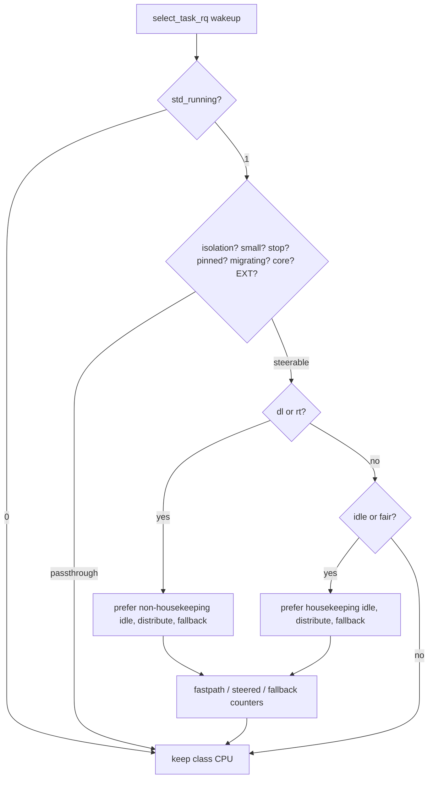

# Smart Task Distributor (STD)

## Overview

STD aims to provide better desktop interactivity by trying to better distribute higher priority tasks such as tasks handled by the DL and RT schedulers to not badly impact normal or lower priority tasks such as tasks handled by the Fair and sched-ext schedulers.

STD steers wakeups without a new scheduling class. Fair and idle tasks prefer housekeeping CPUs. Deadline and real-time tasks prefer non-housekeeping CPUs. Affinity uses `cpumask` intersection with fallback soft hint. Stop tasks are never intercepted while pinned, migrate-disabled and core-scheduled pass through.

> [!NOTE]
> STD will disable itself for machines with less than 3 cores.

## Project Structure

```text
.
├── src/                          # reference sources (std.c, std.h)
├── patches/vanilla-arch/7.3/     # 0001..0004 + series (v7.3 only)
│   ├── 0001-std-kconfig.patch
│   ├── 0002-std-build.patch
│   ├── 0003-std-shim.patch       # sysctl, stats table, boot param
│   ├── 0004-std-hooks.patch      # select_task_rq hook
│   └── series
├── scripts/
│   ├── install.sh                # apply, build, install, health gate
│   ├── uninstall.sh              # reverse + allowlisted --remove
│   └── cleanup.sh                # stale objects (*.orig/*.rej, std.o)
├── benchmarks/                   # placeholder for wakeup measurements
└── linux-fresh-7.3/              # target tree (never committed)
```

## Quick Start

```bash
# preview only (no mutation)
bash -n scripts/install.sh
shellcheck scripts/install.sh
scripts/install.sh --dry-run --boot-dir /tmp/mock-boot linux-fresh-7.3
scripts/install.sh --status --boot-dir /tmp/mock-boot linux-fresh-7.3

# install (two-key guard)
scripts/install.sh --yes linux-fresh-7.3

# with opt-ins
scripts/install.sh --yes --install-deps linux-fresh-7.3
scripts/install.sh --yes --reinstall-nvidia linux-fresh-7.3
scripts/install.sh --yes --write-modprobe linux-fresh-7.3
scripts/install.sh --yes --write-bls linux-fresh-7.3

# revert / prune
scripts/uninstall.sh --dry-run linux-fresh-7.3
scripts/uninstall.sh --remove --yes linux-fresh-7.3
```

## Verify

```bash
uname -r
# expect 7.3.0-std (clean) or 7.3.0-std-dirty (expected dirt only)
sysctl kernel.std_running
# expect 1
cat /proc/sys/kernel/std_running /proc/sys/kernel/std_stats
# expect 1 plus bordered table with fastpath / steered / fallback
taskset -c 0 sleep 0
taskset -p $$
```

Confirm with `patch --dry-run`, `git apply --check` and `checkpatch.pl --strict`. Build scheduler objects and test affinity with `taskset`.

## Tunables

| Tunable | Path | Range | Default | Description |
|---|---|---|---|---|
| `std_running` | `/proc/sys/kernel/std_running` | `0` or `1` | `1` | Master switch. `0` disables steering, `1` enables. |
| `std_stats` | `/proc/sys/kernel/std_stats` | — | — | Dynamic-width bordered table of per-CPU sums (`fastpath`, `steered`, `fallback`); `slab.h`, `kmalloc_array` + `kmalloc` + `kfree`, measured widths, `memory_read_from_buffer`. |

> [!TIP]
> This is optional. After booting the STD entry, verify steering without changing boot config via `cat`, `taskset`, and `sysctl` above (restore to `1` afterwards).

## Flow



## Feature Comparison

| Feature | Vanilla Kernel | With STD | sched-ext |
|---|---|---|---|
| New scheduling class | — | No (shim above deadline) | Yes (`sched_ext`) |
| Fair/idle prefer housekeeping | No | Yes (soft hint, affinity-safe) | Policy-dependent |
| Deadline/RT prefer non-housekeeping | No | Yes (idle + distribute) | Policy-dependent |
| Small-system guard (<3 CPUs) | — | Pass-through | Varies |
| Live toggle | — | `kernel.std_running` + `std_running=` | Varies |
| Read-only stats table | — | `kernel.std_stats` bordered, `-EROFS` on write | Varies |
| Fail-closed install | — | `sudo -n` only, `dry-run`/`status` no-mutate, `checkpatch --strict` | — |

## Maintenance notes (low-risk findings, docs-only)

Prune rotation (no code change): stale `7.3.0-dirty` boot/modules artifacts
(12 `.ko` under `/lib/modules/7.3.0-dirty`, BLS `*-7.3.0-dirty.conf`,
`/boot/<machine-id>/7.3.0-dirty/{linux,initrd}`) are pruned only via the
allowlisted path in `docs/reinstall-runbook.md` step 1
(`uninstall.sh --remove --yes`, refuses the running kernel, requires `sudo -n`).
Coverage is allowlisted only: `vmlinuz-<ver>` / `System.map-<ver>` /
`initramfs-<ver>.img` under `BOOT_DIR`, BLS `*ver*`, Limine STD block
(4 candidates + backup/rollback), exact `/lib/modules/<ver>`, DKMS `-k <ver>`,
and the `-dirty` sibling when the target is clean. Bare `7.3.0-dirty` is never
treated as STD. `/boot` pressure (`4.9G`, `61%`, `2.0G` avail) comes from
redundant initramfs images plus `limine_history` (`812M`: `3x253M` initramfs +
`3x18M` vmlinuz, owned by `limine-snapper-sync` and out of scope for `--remove`);
never `rm -rf` `/boot` or `/lib/modules` by hand.

Read-only wording (no code change): `--status` prints
`Status (read-only, no changes made)` through
`Status complete (read-only, no changes made)` (cleanup: `Status (read-only,
no files removed)`) and exits `0`. `--dry-run` prints `Dry-run OK.
No changes made` (uninstall: `Reverse dry-run OK. No changes made`; cleanup:
`Dry-run: no files removed`) and exits `0` only when preflight passes;
a failing preflight (`may already be applied`) exits `1` and is the signal to
revert first — not a bug. Live `make -s kernelrelease` is the source of truth;
`include/config/kernel.release` is a stale build artifact (regenerated by
`make prepare`) and is never trusted. Limine `*.std-backup-*` plus
`.bak`/`.old` are preserved for manual restore and never auto-deleted.

Build/perf (no code change): `6480` `.ko` / `2.3G` under
`/lib/modules/7.3.0-std` is healthy (`>=1000` gate); `DEBUG_INFO=y` + `BTF`
bloat is inherited from the running config, not forced by STD. `make clean`
(cold) keeps `.config` by design (never `mrproper`/`distclean`).
`JOBS="$(nproc)"` is unbounded by design; constrain manually via
`env MAKEFLAGS=-jN` when needed (no auto-cap).

Security (no code change): `realpath -m` supports mocked `--boot-dir` paths
that may not exist yet; safety comes from the refuse-root/same/nested guards.
Unquoted `${missing_pkgs}`/`${distro_pkgs}` is intentional word-splitting
(one arg per allowlisted package; `SC2086` disabled inline). `/tmp/std-*`
uses `mktemp` (`0600`); prune files only via `rm -f /tmp/std-*`. GRUB stays
warn-only with backup preserved for manual restore
(`sudo -n cp -a backup cfg`); only Limine auto-rolls-back, by design.
`SC2012` `ls` uses are log-only preset preview / newest-backup pick with
inline `SC2012` disables and no behavior change. All privileged steps stay
`sudo -n` only.

## License

SPDX `GPL-2.0` (see `LICENSE`; kernel `COPYING` is GPL version 2).
