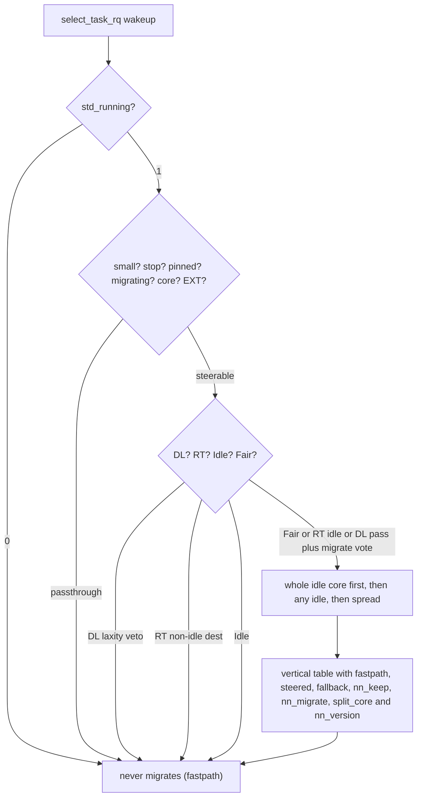

# Smart Task Distributor (STD)

## What is this?

STD aims to provide better desktop interactivity and multitasking performance.

## Why?

We have similar projects like the [scx_flow](https://github.com/galpt/scx_flow_new) and [Infinity](https://github.com/galpt/infinity-scheduler) schedulers, but trying new ideas is hard once a project is considered somewhat stable.

STD is a place to try those ideas without shaking the stable ones. Some ideas arrive proven from Infinity and scx_flow. Others come from papers or are our own. Trying them here lets scx_flow and Infinity stay stable.

## How does it work?

When a task wakes up, it becomes ready to run and the kernel must pick a CPU for it. STD looks at that pick and may move it toward idle capacity. A tiny model with fixed weights reads the last 64 wakeup CPUs for the task and votes to stay put or to move. It only guesses patterns. It learns nothing at runtime.

Right now STD carries a small predictor that votes to stay or to move. It looks at the last 64 CPUs a task woke up on and feeds them through 16 ReLU units built from s8 weights and s32 sums to reach one verdict. Each class then uses that vote in its own way. Deadline tasks stay when laxity drops below 2 ms, where laxity means time left minus work left. Real-time tasks move only to an idle CPU. Fair tasks move when the vote says move and a free allowed CPU exists. Idle tasks never move. The vote sees only past placements, so it stays cheap compared with older averaging tricks.

Allowed CPUs always win. STD picks only from the CPUs the task may run on and otherwise keeps the first choice. A threshold knob tunes eagerness, and higher values move less often. Deadline tasks with little laxity left stay put. Real-time tasks move only when the destination is idle. Fair tasks follow the vote. Idle tasks never move. A few cases pass through untouched. Systems with fewer than three online CPUs stay on the old path, and so do stop tasks and tasks pinned to one CPU. The same holds for tasks with migration turned off and for core-scheduled or extensible SCX tasks. Setting the std_running switch to 0 also leaves every choice alone at near-zero cost. The rest are tried first on a fully idle core, then on any idle CPU, and then by spread fallback. Each result is counted in a small vertical table of metrics and values.



## Project Structure

```text
.
├── src/                          # reference sources (std.c, std.h)
├── patches/vanilla-arch/7.3/     # 0001..0005 + series (v7.3 only)
│   ├── 0001-std-kconfig.patch
│   ├── 0002-std-build.patch
│   ├── 0003-std-shim.patch       # sysctl, stats table, boot params, history
│   ├── 0004-std-hooks.patch      # select_task_rq hook + fork init
│   ├── 0005-std-trace.patch      # scheduler trace documentation
│   └── series
├── scripts/
│   ├── install.sh                # apply, build, install, health gate
│   ├── uninstall.sh              # reverse + allowlisted --remove
│   ├── verify-std.sh             # extended 7-row gate
│   └── cleanup.sh                # stale objects (*.orig/*.rej, std.o)
├── benchmarks/                   # wakeup and predictor counters
└── linux-fresh-7.3/              # target tree (never committed)
```

## Quick Start

```bash
# preview only (no mutation)
bash -n scripts/install.sh
shellcheck scripts/install.sh
scripts/install.sh --dry-run --boot-dir /tmp/mock-boot linux-fresh-7.3
scripts/install.sh --status --boot-dir /tmp/mock-boot linux-fresh-7.3

# install (two-key guard)
scripts/install.sh --yes linux-fresh-7.3

# with opt-ins
scripts/install.sh --yes --install-deps linux-fresh-7.3
scripts/install.sh --yes --reinstall-nvidia linux-fresh-7.3
scripts/install.sh --yes --write-modprobe linux-fresh-7.3
scripts/install.sh --yes --write-bls linux-fresh-7.3

# revert / prune
scripts/uninstall.sh --dry-run linux-fresh-7.3
scripts/uninstall.sh --remove --yes linux-fresh-7.3
```

## Verify

```bash
uname -r
# expect 7.3.0-std (clean) or 7.3.0-std-dirty (expected dirt only)

sysctl kernel.std_running kernel.std_nn_thresh
# expect 1 (steering, default) and threshold s32; 0 disables steering

cat /proc/sys/kernel/std_running
# expect 1
```

You can also use `cat /proc/sys/kernel/std_stats` to check whether STD works as intended.

```bash
# expect something like the table below

~
❯ cat /proc/sys/kernel/std_stats
+------------+-------+
| metric     | value |
+------------+-------+
| fastpath   |  139M |
| steered    |   34M |
| fallback   |  533K |
| nn_keep    |   80M |
| nn_migrate |   94M |
| split_core |  7.7M |
| nn_version |     1 |
+------------+-------+

~
❯

```

> [!TIP]
> 1. `fastpath` keeps the class CPU.
> 2. `steered` moves to a new CPU.
> 3. `fallback` keeps the class CPU when no usable CPU remains in the allowed mask.
> 4. `nn_keep` counts predictor votes to stay.
> 5. `nn_migrate` counts predictor votes to move.
> 6. `split_core` counts picks that share a core with a busy sibling.
> 7. `nn_version` is the predictor identity and stays at 1.

## Tunables

| Tunable | Path | Range | Default | Description |
|---|---|---|---|---|
| `std_running` | `/proc/sys/kernel/std_running` | `0` or `1` | `1` | Master switch. `1` steering (default), `0` off (near-zero cost). |
| `std_nn_thresh` | `/proc/sys/kernel/std_nn_thresh` | `s32` | `0` | Predictor threshold. Larger values make migration rarer. |
| `std_stats` | `/proc/sys/kernel/std_stats` | n/a | n/a | Vertical 2-column metric/value table of per-CPU sums (`fastpath`, `steered`, `fallback`, `nn_keep`, `nn_migrate`, `split_core`, `nn_version` const); measured widths, `memory_read_from_buffer`. |
| `std_nn_version` | `src/std.h` const + stats row | n/a | `1` | Predictor identity; bumped when weights or semantics change. |

> [!TIP]
> This is optional. After booting the STD entry, confirm steering with `cat`, `taskset`, and `sysctl` above (restore to `1` afterwards) without altering boot configuration.

## Feature Comparison

> [!NOTE]
> STD pauses on fewer than three online CPUs and runs under any
> standard boot configuration without further prerequisites.

| Feature | Vanilla Kernel | With STD | sched-ext |
|---|---|---|---|
| Scheduling classes | n/a | Existing hierarchy retained; wakeup choice | Yes (`sched_ext`) |
| Boot prerequisites | n/a | Standard boot suffices | n/a |
| Predictor | n/a | Tiny 64-16-1 s8/s32 ReLU threshold | Policy-dependent |
| Fair placement | EEVDF with SIS via `select_task_rq_fair` | Opportunistic, affinity-safe | Policy-dependent |
| RT placement | FIFO/RR push/pull via `select_task_rq_rt` | Idle destination only | No (higher class preempts SCX) |
| DL placement | CBS/EDF placement via `select_task_rq_dl` | Laxity veto, else opportunistic | No (higher class preempts SCX) |
| Idle placement | Pinned returns `task_cpu` via `select_task_rq_idle` | Never migrates | n/a |
| Small-system guard (<3 CPUs) | n/a | Pass-through | Varies |
| Live toggle | n/a | `kernel.std_running` (`0`/`1`) + `std_running=`, `kernel.std_nn_thresh` + `std_nn_thresh=` | Varies |
| Read-only stats table | n/a | `kernel.std_stats` vertical 2-column metric/value, `-EROFS` on write | Varies |
| Fail-closed install | n/a | `sudo -n` only, `dry-run`/`status` no-mutate, `checkpatch --strict` | n/a |

## Contributing

PRs are welcome if you want to help add support for other Linux distros. Use of AI to help with the PR is acceptable if you have tested each PR carefully, with added proofs in the PR, a good commit description of what each commit contains, and a good PR body.

Low effort PRs with almost no care for the structure and writing style of the STD codebase will almost certainly be rejected. The `CONTRIBUTING.md` file with details on how to contribute to this project will be added after we consider this repo ready for the public to contribute.

## License

See the `LICENSE` file.
