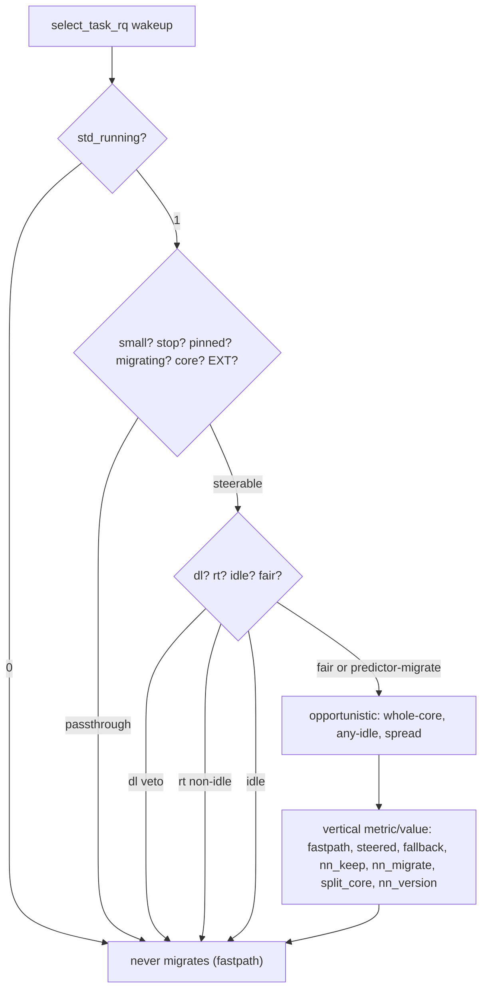

# Smart Task Distributor (STD)

## Overview

STD refines the CPU chosen at wakeup toward idle capacity. Fair
tasks consult a tiny fixed-point predictor; real-time tasks accept
only idle destinations; deadline tasks respect a laxity veto before
consulting the predictor; idle tasks remain in place. Extensible
tasks stay with SCX and remain outside steering.

The predictor maps 64 history inputs through 16 hidden units to one
verdict, combining s8 coefficients into s32 sums with ReLU and a
threshold in integer non-sleeping context. Per-task history (64 u8
entries plus a cursor) accrues at wakeup and resets at fork.
Candidates derive from the allowed mask, preferring a fully idle
core, then any idle CPU, then a spread fallback. Affinity resolves
through mask intersection, reverting to the class choice when
constrained. Stop, pinned, migrate-disabled, core-scheduled
(rq-wide, may over-skip) and extensible tasks retain their course.

> [!NOTE]
> STD pauses on fewer than three online CPUs and runs under any
> standard boot configuration without further prerequisites.

## Project Structure

```text
.
├── src/                          # reference sources (std.c, std.h)
├── patches/vanilla-arch/7.3/     # 0001..0005 + series (v7.3 only)
│   ├── 0001-std-kconfig.patch
│   ├── 0002-std-build.patch
│   ├── 0003-std-shim.patch       # sysctl, stats table, boot params, history
│   ├── 0004-std-hooks.patch      # select_task_rq hook + fork init
│   ├── 0005-std-trace.patch      # scheduler trace documentation
│   └── series
├── scripts/
│   ├── install.sh                # apply, build, install, health gate
│   ├── uninstall.sh              # reverse + allowlisted --remove
│   ├── verify-std.sh             # extended 7-row gate
│   └── cleanup.sh                # stale objects (*.orig/*.rej, std.o)
├── benchmarks/                   # wakeup and predictor counters
└── linux-fresh-7.3/              # target tree (never committed)
```

## Quick Start

```bash
# preview only (no mutation)
bash -n scripts/install.sh
shellcheck scripts/install.sh
scripts/install.sh --dry-run --boot-dir /tmp/mock-boot linux-fresh-7.3
scripts/install.sh --status --boot-dir /tmp/mock-boot linux-fresh-7.3

# install (two-key guard)
scripts/install.sh --yes linux-fresh-7.3

# with opt-ins
scripts/install.sh --yes --install-deps linux-fresh-7.3
scripts/install.sh --yes --reinstall-nvidia linux-fresh-7.3
scripts/install.sh --yes --write-modprobe linux-fresh-7.3
scripts/install.sh --yes --write-bls linux-fresh-7.3

# revert / prune
scripts/uninstall.sh --dry-run linux-fresh-7.3
scripts/uninstall.sh --remove --yes linux-fresh-7.3
```

## Verify

```bash
uname -r
# expect 7.3.0-std (clean) or 7.3.0-std-dirty (expected dirt only)
sysctl kernel.std_running kernel.std_nn_thresh
# expect 1 (steering, default) and threshold s32; 0 disables steering
cat /proc/sys/kernel/std_running /proc/sys/kernel/std_nn_thresh /proc/sys/kernel/std_stats
# expect 1 plus threshold plus vertical 2-column metric/value table
# (fastpath / steered / fallback / nn_keep / nn_migrate / split_core / nn_version)
taskset -c 0 sleep 0
taskset -p $$
```

Confirm with `patch --dry-run`, `git apply --check` and `checkpatch.pl --strict` (near-zero disabled cost when off). Build scheduler objects and test affinity with `taskset`; steering on by default, 0 disables.

## Tunables

| Tunable | Path | Range | Default | Description |
|---|---|---|---|---|
| `std_running` | `/proc/sys/kernel/std_running` | `0` or `1` | `1` | Master switch. `1` steering (default), `0` off (near-zero cost). |
| `std_nn_thresh` | `/proc/sys/kernel/std_nn_thresh` | `s32` | `0` | Predictor threshold. Larger values make migration rarer. |
| `std_stats` | `/proc/sys/kernel/std_stats` | — | — | Vertical 2-column metric/value table of per-CPU sums (`fastpath`, `steered`, `fallback`, `nn_keep`, `nn_migrate`, `split_core`, `nn_version` const); measured widths, `memory_read_from_buffer`. |
| `std_nn_version` | `src/std.h` const + stats row | — | `1` | Predictor identity; bumped when weights or semantics change. |

> [!TIP]
> This is optional. After booting the STD entry, confirm steering with `cat`, `taskset`, and `sysctl` above (restore to `1` afterwards) without altering boot configuration.

## Flow



Guards apply in code order; deadline tasks meet a laxity veto,
real-time tasks require idle destinations, fair tasks heed the predictor, idle tasks stay put.

## Feature Comparison

| Feature | Vanilla Kernel | With STD | sched-ext |
|---|---|---|---|
| Scheduling classes | — | Existing hierarchy retained; wakeup refinement | Yes (`sched_ext`) |
| Boot prerequisites | — | Standard boot suffices | — |
| Predictor | — | Tiny 64-16-1 s8/s32 ReLU threshold | Policy-dependent |
| Fair placement | No | Opportunistic, affinity-safe | Policy-dependent |
| RT placement | No | Idle destination only | No (higher class preempts SCX) |
| DL placement | No | Laxity veto, else opportunistic | No |
| Idle placement | No | Never migrates | — |
| Small-system guard (<3 CPUs) | — | Pass-through | Varies |
| Live toggle | — | `kernel.std_running` (`0`/`1`) + `std_running=`, `kernel.std_nn_thresh` + `std_nn_thresh=` | Varies |
| Read-only stats table | — | `kernel.std_stats` vertical 2-column metric/value, `-EROFS` on write | Varies |
| Fail-closed install | — | `sudo -n` only, `dry-run`/`status` no-mutate, `checkpatch --strict` | — |

## License

See the `LICENSE` file.
